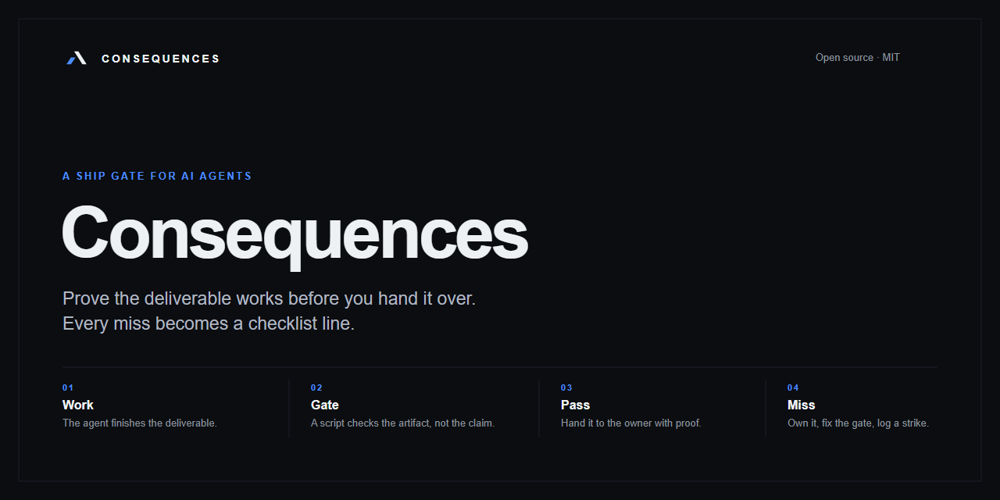
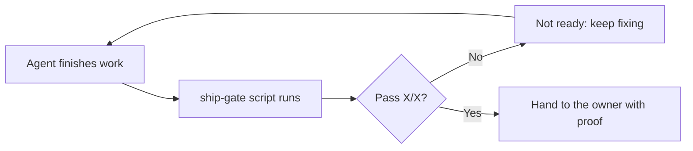
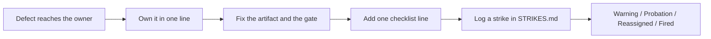
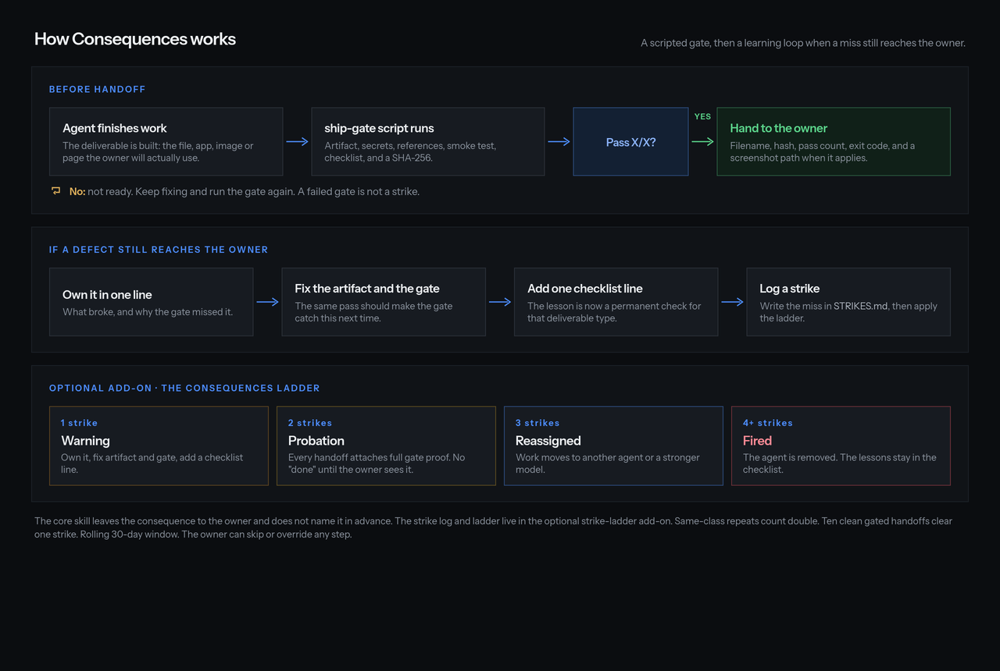

<p align="center">
  
</p>

<p align="center">
  <a href="LICENSE"></a>
  <a href="https://github.com/arbhlabs/consequences/releases"></a>
  
</p>

# Consequences

A scripted ship gate for AI agents. It makes an agent prove a deliverable works before handing it to you. When a miss still reaches you, the agent owns it in one line, fixes the gate, and adds a checklist line so that class of mistake is harder to ship twice.

Formerly ship-gate. Built by [ARBH Labs](https://arbhlabs.com).

## Why it exists

AI agents are good at writing code and bad at admitting the result does not work yet. The familiar version is a report that says every tab passed, then the app shows placeholders and a 401.

Consequences closes that gap with cheap scripted proof, not another model review. A smaller model that has to pass this gate ships cleaner work than a larger one that does not. The owner is the customer, not the test lab. If it breaks on your screen, it is a production defect.

## How it works





<p align="center">
  
</p>

The runner is a Bash script, [`templates/gate.sh`](templates/gate.sh). It checks that the artifact exists, scans for obvious secret assignments, runs your reference checker, runs your smoke test, and requires a completed checklist. For UI work it also checks that a screenshot file exists and that visual review was attested. It cannot inspect pixels or prove that someone opened the image.

If the gate fails, the work is not ready. The agent keeps fixing it. A failed gate is not a strike.

If the gate passes and a defect still reaches you, the agent:

1. Owns it in one line: what broke and why the gate missed it.
2. Fixes the artifact and the gate in the same pass.
3. Adds one line to the checklist for that deliverable type.

The core skill leaves the next step to you. It does not name it in advance. The optional [strike ladder](addons/strike-ladder/SKILL.md) writes a default list, if you want one.

### The gate, in short

1. Test the artifact, not the source.
2. Every reference resolves through a project-specific checker.
3. Run the real entry point once; exit code 0.
4. For screen-based work, open and inspect a real screenshot.
5. Run the completed checklist, including every lessons-learned line.
6. Report the proof, or say "not ready".

Full text: [`skills/ship-gate/SKILL.md`](skills/ship-gate/SKILL.md)

## A real gate run

The recording below is a real run of `templates/gate.sh` against [`examples/sample`](examples/sample). First the smoke test and checklist fail (`gate: pass 4/6`). After adding `VERSION` and completing the checklist, the same runner reports `gate: pass 6/6`.

<p align="center">
  
</p>

## Install

**Windows, easiest (one click):** download **[ConsequencesSetup.exe](https://github.com/arbhlabs/consequences/releases/latest/download/ConsequencesSetup.exe)** and double-click it.
- Tick what you want:
  - the Consequences skill
  - the points add-on
  - the optional **Consequences Brain** window
- Press **Install**.

You don't need admin rights or Python. Uninstall from Settings → Apps. The installer isn't code-signed yet, so if SmartScreen asks, choose **More info → Run anyway**.

**macOS / Linux**
```bash
curl -fsSL https://raw.githubusercontent.com/arbhlabs/consequences/main/install.sh | bash
```

**Windows (PowerShell)**
```powershell
irm https://raw.githubusercontent.com/arbhlabs/consequences/main/install.ps1 | iex
```

These install `SKILL.md`, `templates/gate.sh` and `templates/CHECKLIST.md` to `~/.claude/skills/ship-gate/` (Claude Code). Re-run them anytime to update.

**Other agents:** copy `skills/ship-gate/SKILL.md` and the `templates/` directory alongside it into your agent's rules or skills folder (for example `.cursor/rules/`, `AGENTS.md`, or `GEMINI.md`), or paste the skill into the system prompt and keep the runner/checklist available at a known path.

## Consequences Brain: watch your agents live (optional)

<p align="center">
  
</p>

The Brain is an optional desktop window for the points add-on. Install it with **ConsequencesSetup.exe**, or skip it: the skill works fine on its own.

- **Who leads.** Each agent is a glowing node. Size is net score and colour is standing (green, yellow, orange, red). Higher means better standing.
- **Who is working right now.** The node pulses and a comet circles it.
  - Claude Code sessions are picked up from their transcripts automatically, with no hooks.
  - Any other agent announces itself with one command.
- **Colour and detail.** Green is the top 3, then yellow (+20 or more), orange (0 to +19) and red (below 0). Click a runner for a plain-language view of what it is doing, its recent points and its lessons.
- **Who is waiting for points.** When an agent finishes with `Points for this? Suggested: +N (why)`, it gets a gold card. One click on **Accept** writes it to your ledger. Work without that line goes to a quiet group that expires after 12 hours.
- **First run.** An empty scoreboard explains how points get in, with copy buttons for this install's real commands. **Show sample data** lets you look around without writing anything.
- **Award from the command line.** The installed app needs no Python: `& "$env:LOCALAPPDATA\Programs\Consequences Brain\ConsequencesBrain.exe" award "My agent" +5 "what it did"`.
- **Ranks.** Points earn rank. A Lead (+100) may suggest points for other agents. Ranks and rules are read live from your skill.
- **Lean.** The watchers sleep in the OS until something changes, and updates show in under 1 s. The window works at any size: full screen, snapped to half, or tiny.

<p align="center">
  
  
</p>

Claude Code needs no setup. Other agents run `working` at the start and `done` at the end. Install, uninstall, hooks, settings and the OpenCode bridge: [`addons/brain`](addons/brain/README.md). Screenshots use a fictional sample ledger.

## Usage

The runner requires explicit project-specific reference and smoke-test scripts plus a completed checklist. The helpers receive the artifact path as `$1`; they must inspect the exact artifact and return nonzero on failure. They are invoked as script paths, not evaluated command strings.

```bash
bash "$HOME/.claude/skills/ship-gate/templates/gate.sh" ./dist/deliverable \
  --refs-check ./scripts/check-refs.sh \
  --smoke-script ./scripts/smoke-test.sh \
  --checklist ./CHECKLIST.md
```

For a UI or other screen-based deliverable, first open and inspect the screenshot, then append:

```bash
  --ui --screenshot ./artifacts/release.png --visual-reviewed
```

The runner confirms that a screenshot file exists and requires an explicit review attestation. It cannot inspect image pixels or independently prove that the screenshot was opened. The secret scan is heuristic and does not scan Git history; audit repository history separately when required.

Run the regression tests with:

```bash
bash tests/test-gate.sh
```

## Templates

- [`templates/CHECKLIST.md`](templates/CHECKLIST.md): a per-deliverable checklist with a Lessons section that grows with every miss; the gate blocks handoff while any checkbox remains open.
- [`templates/gate.sh`](templates/gate.sh): a configurable gate runner with required reference, smoke-test and checklist inputs; no `eval`.
- [`templates/STRIKES.md`](templates/STRIKES.md) and [`addons/strike-ladder/STRIKES.md`](addons/strike-ladder/STRIKES.md): the strike log used by the optional ladder.
- [`templates/points/SCOREBOARD.md`](templates/points/SCOREBOARD.md): a starter scoreboard for the optional points add-on.

## The consequences ladder

If you want a written list of what happens after a miss reaches you, add the optional [`strike ladder`](addons/strike-ladder/SKILL.md). Each of those misses is a strike, recorded in [`STRIKES.md`](addons/strike-ladder/STRIKES.md).

| Strikes (rolling 30 days) | Status | What happens |
|---|---|---|
| 0 | Trusted | The agent works as usual. |
| 1 | Warning | The agent says what went wrong, in one line. It fixes the work and the gate, and adds a checklist line so that mistake is harder to repeat. |
| 2 | Probation | The agent cannot call the work "done" until the owner has seen the proof. Every handoff must include the full gate result and a screenshot. |
| 3 | Reassigned | This work goes to another agent or a stronger model. The original agent only does small, reviewed, low-risk tasks. |
| 4+ | Fired | Last resort. The owner stops using that agent or model. |

Fired is a last resort, and it has not been needed yet. If an agent or model keeps missing what was asked, or keeps frustrating the owner, the owner stops using it. In an extreme case, the owner could uninstall the program. Lessons already written in the checklist stay there.

A strike for the same kind of mistake already in the checklist counts double. A clean streak of 10 gated handoffs clears one strike. The owner can skip or override any step. Before every handoff, the agent reads `STRIKES.md` and states its current status in the report.

There is also a [points add-on](addons/points/SKILL.md) if you want to score work with plus and minus points. When the owner awards or deducts points, the agent backs up the skill and scoreboard, appends the event to the scoreboard, appends a new lesson to the skill, and says that it was recorded. The public templates use generic examples only; keep your own lesson log free of personal names, device names, and private paths.

## FAQ

### Is this a neural network or a model?

No. Consequences is a skill file plus a scripted gate. The learning loop is a checklist that grows by one line after each miss, plus an optional strike log or points scoreboard.

### Does the installer work with Cursor or Codex?

The install scripts place files in the Claude Code skills directory. For Cursor, Codex and other agents, copy the skill and templates into that agent's rules or skills folder, as described in the install section.

### What is the latest version?

The skill on `main` is currently 1.6.1. GitHub Releases may lag behind `main`; the install commands always fetch from `main`.

### Can the runner tell whether a screenshot was actually opened?

No. It checks that the file exists and that `--visual-reviewed` was passed. The agent still has to open and inspect the image.

### Does the secret scan cover Git history?

No. It is a heuristic over the artifact only. Audit repository history separately when required.

## Stay updated

Watch or star this repo for releases. Changes are listed in [CHANGELOG.md](CHANGELOG.md). The skill is versioned in its front matter.

## Contributing

Found a class of mistake your agents keep shipping? Open an issue with the one-line lesson and the check that catches it. Good lessons get folded into the skill. Please keep examples generic: no personal names, private paths, or incident details from a real household or company.

## License

MIT © 2026 Aaron Haug / [ARBH Labs](https://arbhlabs.com)
