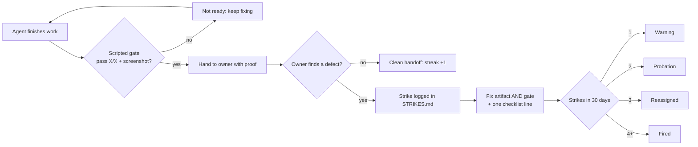

# ship-gate

**Stop your AI agents from saying "done" when it isn't.**

`ship-gate` is a drop-in agent skill that makes every AI coding agent (Claude Code, Cursor, Codex, Gemini, Copilot, and others) prove a deliverable works *before* handing it to you, then turns every miss into a permanent check, so the same mistake never ships twice.

It's built on one idea from real companies: **the owner is the customer, not the test lab.** If it breaks on your screen, it's a production defect.

## Why

AI agents are great at writing code and bad at admitting it doesn't work yet. You've seen it: "All tabs PASS ✅", and then the app shows `--` everywhere and a 401. ship-gate closes that gap with cheap scripted proof instead of more AI review.

- **Cheap:** scripts, not extra model passes. A tiny model following this skill ships cleaner than a big one without it.
- **Proof, not vibes:** no "done" without filename, version/hash, pass X/X, exit code and a screenshot that was actually opened.
- **Self-improving:** every defect adds one checklist line, so your gate gets stronger with each mistake.
- **Accountable:** the agent owns misses in one line, fixes the artifact *and* the gate, and leaves consequences to you.

## How it keeps agents in line

ship-gate treats your agents like employees at a real company. The job is on the line:



| Strikes (30 days) | Status | Consequence |
|---|---|---|
| 0 | Trusted | Normal autonomy |
| 1 | Warning | Own it, fix artifact + gate, add a checklist line |
| 2 | Probation | Full proof + screenshot on every handoff |
| 3 | Reassigned | Work moves to another agent/model |
| 4+ | Fired | Removed from the project; its lessons stay |

Repeat the same class of mistake and it counts double. Ten clean handoffs clear a strike. Every agent states its status in every report, so it always knows where it stands.

## The gate (in short)

1. Test the artifact, not the source.
2. Every reference resolves (paths, files, URLs, env vars).
3. Run the real entry point once; exit 0.
4. Look at it: open a real screenshot; placeholders, errors or overlap = fail.
5. Run the checklist, including every lessons-learned line.
6. Report the proof, or say "not ready".

Full text: [`skills/ship-gate/SKILL.md`](skills/ship-gate/SKILL.md)

## Install (always gets the latest)

**macOS / Linux**
```bash
curl -fsSL https://raw.githubusercontent.com/arbhlabs/ship-gate/main/install.sh | bash
```

**Windows (PowerShell)**
```powershell
irm https://raw.githubusercontent.com/arbhlabs/ship-gate/main/install.ps1 | iex
```

These install to `~/.claude/skills/ship-gate/` (Claude Code). Re-run them anytime to update.

**Other agents:** copy `skills/ship-gate/SKILL.md` into your agent's rules or skills folder (for example `.cursor/rules/`, `AGENTS.md`, or `GEMINI.md`), or just paste it into the system prompt.

## Templates

- [`templates/CHECKLIST.md`](templates/CHECKLIST.md): a per-deliverable checklist with a Lessons section that grows with every miss.
- [`templates/STRIKES.md`](templates/STRIKES.md): the strike log agents read before every handoff.
- [`templates/gate.sh`](templates/gate.sh): a minimal gate runner that prints `gate: pass X/X` and fails loudly.

## Stay updated

Watch or star this repo for releases. Changes are listed in [CHANGELOG.md](CHANGELOG.md). The skill is versioned in its front matter.

## Contributing

Found a class of mistake your agents keep shipping? Open an issue with the one-line lesson and the check that catches it. Good lessons get folded into the skill.

## License

MIT © 2026 Aaron Haug / [ARBH Labs](https://arbhlabs.com)
