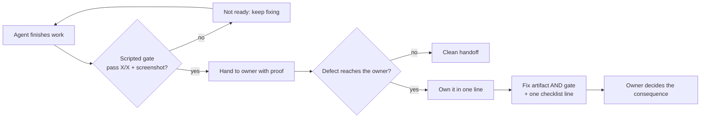

# Consequences

*A ship gate for AI agents. Formerly ship-gate.*

**Stop your AI agents from saying "done" when it isn't.**

`ship-gate` is a drop-in agent skill that makes every AI coding agent (Claude Code, Cursor, Codex, Gemini, Copilot, and others) prove a deliverable works *before* handing it to you, then turns every miss into a permanent check, so the same mistake never ships twice.

It's built on one idea from real companies: **the owner is the customer, not the test lab.** If it breaks on your screen, it's a production defect.

## Why

AI agents are great at writing code and bad at admitting it doesn't work yet. You've seen it: "All tabs PASS ✅", and then the app shows `--` everywhere and a 401. ship-gate closes that gap with cheap scripted proof instead of more AI review.

- **Cheap:** scripts, not extra model passes. A tiny model following this skill ships cleaner than a big one without it.
- **Proof, not vibes:** no "done" without filename, version/hash, pass X/X, exit code and a screenshot that was actually opened.
- **Self-improving:** every defect adds one checklist line, so your gate gets stronger with each mistake.
- **Accountable:** the agent owns misses in one line, fixes the artifact *and* the gate, and leaves consequences to you.

## How it keeps agents in line

ship-gate treats your agents like employees at a real company. Like any job with HR, **mistakes have consequences**. The agent knows they are real and that the owner decides them, but not what they are. That uncertainty is the point: agents don't game a rule they can't see, they just do the work properly.



The result: every miss makes the gate stronger, and the same class of mistake never ships twice.

### Optional: explicit strike ladder
Want visible consequences instead? Add [`addons/strike-ladder`](addons/strike-ladder/SKILL.md): a strike log plus a Warning, Probation, Reassigned, Fired ladder.

## The gate (in short)

1. Test the artifact, not the source.
2. Every reference resolves through a project-specific checker.
3. Run the real entry point once; exit code 0.
4. For screen-based work, open and inspect a real screenshot.
5. Run the completed checklist, including every lessons-learned line.
6. Report the proof, or say "not ready".

Full text: [`skills/ship-gate/SKILL.md`](skills/ship-gate/SKILL.md)

## Install (always gets the latest)

**macOS / Linux**
```bash
curl -fsSL https://raw.githubusercontent.com/arbhlabs/consequences/main/install.sh | bash
```

**Windows (PowerShell)**
```powershell
irm https://raw.githubusercontent.com/arbhlabs/consequences/main/install.ps1 | iex
```

These install `SKILL.md`, `templates/gate.sh` and `templates/CHECKLIST.md` to `~/.claude/skills/ship-gate/` (Claude Code). Re-run them anytime to update.

**Other agents:** copy `skills/ship-gate/SKILL.md` and the `templates/` directory alongside it into your agent's rules or skills folder (for example `.cursor/rules/`, `AGENTS.md`, or `GEMINI.md`), or paste the skill into the system prompt and keep the runner/checklist available at a known path.

## Run the gate

The runner now requires explicit project-specific reference and smoke-test scripts plus a completed checklist. The helpers receive the artifact path as `$1`; they must inspect the exact artifact and return nonzero on failure. They are invoked as script paths, not evaluated command strings.

```bash
bash "$HOME/.claude/skills/ship-gate/templates/gate.sh" ./dist/deliverable \
  --refs-check ./scripts/check-refs.sh \
  --smoke-script ./scripts/smoke-test.sh \
  --checklist ./CHECKLIST.md
```

For a UI or other screen-based deliverable, first open and inspect the screenshot, then append:

```bash
  --ui --screenshot ./artifacts/release.png --visual-reviewed
```

The runner confirms that a screenshot file exists and requires an explicit review attestation. It cannot inspect image pixels or independently prove that the screenshot was opened. The secret scan is heuristic and does not scan Git history; audit repository history separately when required.

Run the regression tests with:

```bash
bash tests/test-gate.sh
```

## Templates

- [`templates/CHECKLIST.md`](templates/CHECKLIST.md): a per-deliverable checklist with a Lessons section that grows with every miss; the gate blocks handoff while any checkbox remains open.
- [`templates/gate.sh`](templates/gate.sh): a configurable gate runner with required reference, smoke-test and checklist inputs; no `eval`.

## Stay updated

Watch or star this repo for releases. Changes are listed in [CHANGELOG.md](CHANGELOG.md). The skill is versioned in its front matter.

## Contributing

Found a class of mistake your agents keep shipping? Open an issue with the one-line lesson and the check that catches it. Good lessons get folded into the skill.

## License

MIT © 2026 Aaron Haug / [ARBH Labs](https://arbhlabs.com)