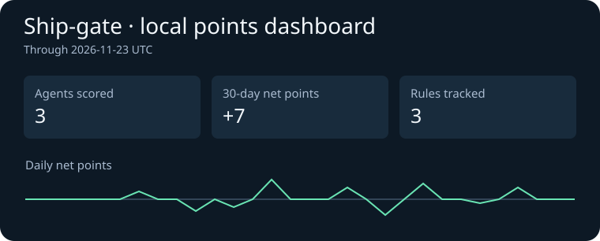
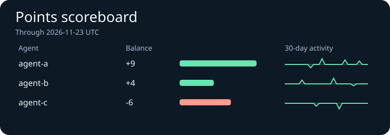

# Ship-gate

[](https://github.com/arbhlabs/consequences/actions/workflows/ci.yml)
[](LICENSE)
[](CHANGELOG.md)

**Require a real test before an AI agent hands over a deliverable.**

Ship-gate gives an agent a checklist and a Bash runner. It checks references, runs your smoke test against the exact deliverable, and prints evidence for the handoff. When a defect slips through, add a check that would have caught it. An optional local points bank tracks owner feedback and ranks lessons for future tasks.

Use it when your agent ships something you can test, such as a package, a script, or a staged app. Exploratory work and subjective reviews still need a person to decide what good looks like.



## Quick start

Requires Git and Bash. On Windows, use PowerShell 7 and put Git for Windows Bash on PATH.

**PowerShell 7**

```powershell
git clone --branch polish-v2 https://github.com/arbhlabs/consequences.git ship-gate
Set-Location ship-gate
bash ./examples/package-demo.sh
```

**macOS / Linux**

```bash
git clone --branch polish-v2 https://github.com/arbhlabs/consequences.git ship-gate
cd ship-gate
bash examples/package-demo.sh
```

Expected highlights:

```text
BEFORE | Agent: done. The package has both files.
FAIL  real smoke script exits 0
AFTER | Resolve config relative to the packaged entry point.
gate: pass 6/6
LESSON | Smoke-run the packaged entry point from a fresh directory.
```

## How it works

| Step | Packaging example |
| --- | --- |
| Task → deliverable | Package a launcher and its config file. The agent sees both files and calls it done. |
| Gate checks → outcome | A smoke test starts the actual launcher from a clean directory and fails. The agent fixes config resolution and reruns the gate. It passes and prints the artifact hash. |
| Lesson → rule | Keep the launch from outside the package in the smoke test and record it in the checklist. Link owner feedback to the rule when points are enabled. |
| Next task | Run the same check on the next package. The points bank can surface the lesson in the agent's watch list. |

[Gate configuration](docs/concepts.md) · [Bash example](examples/package-demo.sh) · [PowerShell example](examples/points-demo.ps1)

## Optional points bank

With Node.js 22 or later, run `node addons/points/points.mjs board --data-dir templates/points --as-of 2026-11-23` from the clone to view the sample data.



| Command | Output |
| --- | --- |
| `award` | Record one explicit owner award |
| `ledger` / `export` | Raw JSON Lines / JSON with derived views |
| `board` | Agent and task balances, trends, streaks, gains, losses and most-docked rules |
| `lessons` | Weekly digest, top rules and an optional per-agent watch list |
| `charts` | Five offline SVGs |

[Points setup](docs/points.md) · [How weights work](docs/learning.md) · [Chart previews](docs/previews/)

<details>
<summary>Install and configure the skill</summary>

From the clone, copy [the skill](skills/ship-gate/SKILL.md) into your agent's skill directory with the runner and checklist from [templates](templates/) in a `templates` subdirectory. The [PowerShell installer](install.ps1) and [Bash installer](install.sh) pull the current files from the default branch and install them for Claude Code.

Create a reference checker and smoke test for your deliverable. To enable points, give the agent [the add-on skill](addons/points/SKILL.md) and the CLI path in your clone. The [strike ladder](addons/strike-ladder/) is available separately.

</details>

<details>
<summary>Uninstall and privacy</summary>

Remove the installed skill directory and any optional add-on instructions you copied. You can remove the clone independently. The points ledger and rules are stored in your per-user data folder, which you can back up or remove separately.

The points CLI runs offline and sends nothing off your machine. Installers download files from GitHub. The gate runs the scripts you supply with your permissions. Keep secrets out of reasons, exports, and screenshots.

</details>

## FAQ

- **Does the gate inspect screenshots?** It checks that the file exists and requires a visual-review attestation. The agent or reviewer must open the screenshot.
- **Can points change permissions?** Scores affect balances and rule ordering. The owner decides any follow-up.
- **Which agents can use it?** Any agent that can read the skill and run the commands in your environment.

[More questions](docs/faq.md)

## Contributing and license

Run `bash tests/test-gate.sh` and `node --test tests/test-points.mjs`. For a new gate check, include a small example that fails before the fix and passes after it. See the [code of conduct](CODE_OF_CONDUCT.md) and [security reporting process](SECURITY.md).

[MIT license](LICENSE) · [Changelog](CHANGELOG.md)
