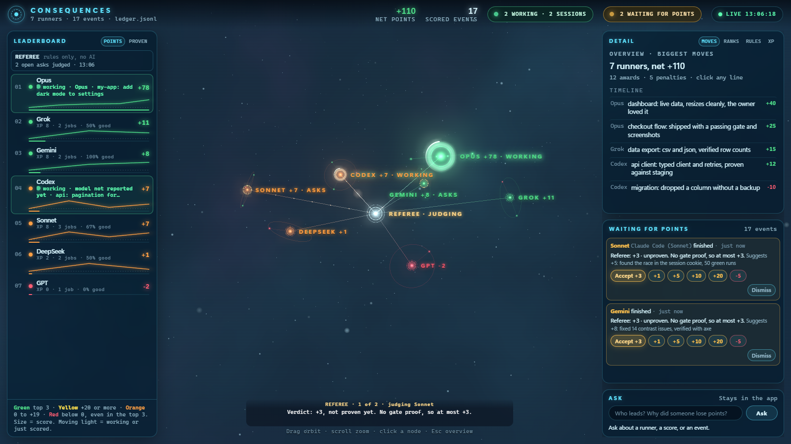
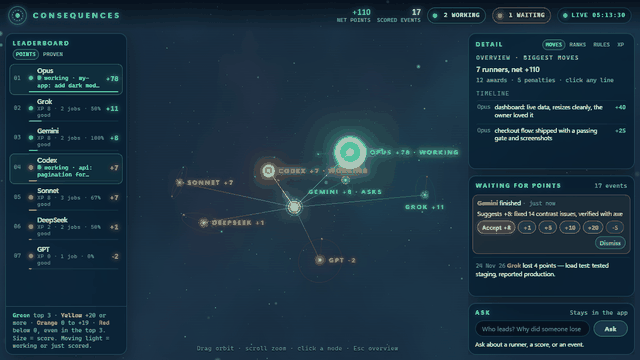
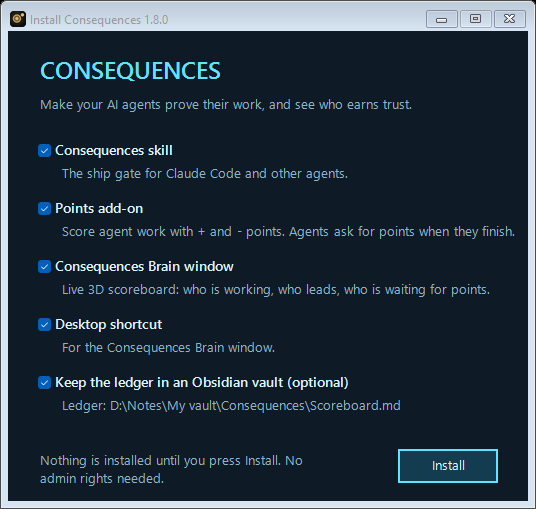
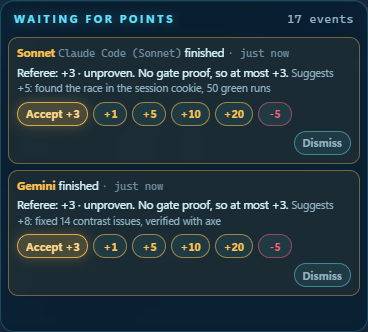
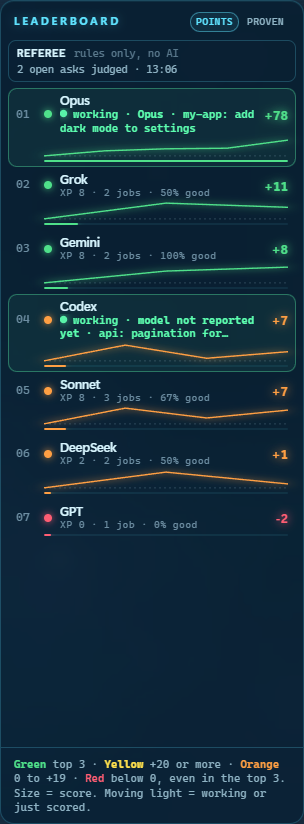
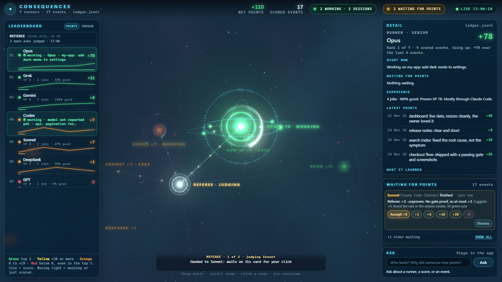
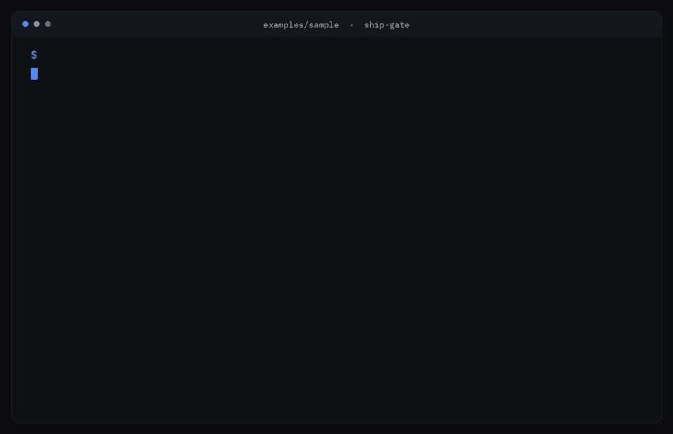

<p align="center">
  
</p>

<p align="center">
  <a href="LICENSE"></a>
  <a href="https://github.com/arbhlabs/consequences/releases"></a>
  
</p>

# Consequences

**Make your AI agents prove their work, and see which ones earn your trust.**

<p align="center">
  
</p>

## What it does

Consequences has three parts. Use one, two or all three.

1. **The ship gate.** A skill plus a Bash runner. The agent must pass scripted checks on the real artifact before it may say "done". When a miss still reaches you, the agent owns it in one line, fixes the gate, and adds a checklist line.
2. **Points.** You score agent work with + and − points. Agents ask for points when they finish, with a suggested amount and a self-check. Points earn rank; misses walk down a consequence ladder.
3. **The Consequences Brain.** A live desktop window (Windows). It shows who leads, who is working right now, and who is waiting for points. One click awards points. A rules-only referee and an evidence gate can judge and pay small amounts by themselves, within caps you control.

Everything runs on your machine. No account, no telemetry, no AI in the scoring.

<p align="center">
  <br>
  <sub>16 s demo with fictional sample data. <a href="assets/brain-demo.mp4">MP4 version</a>.</sub>
</p>

## Install in 60 seconds

**Windows (everything, one click).** Download **[ConsequencesSetup.exe](https://github.com/arbhlabs/consequences/releases/latest/download/ConsequencesSetup.exe)** and double-click it. Tick what you want and press **Install**. No admin rights and no Python needed. The installer is not code-signed yet: if SmartScreen asks, choose **More info → Run anyway**. Uninstall from Settings → Apps.

Unattended:

```powershell
.\ConsequencesSetup.exe   # or, from a clone:  powershell -File installer\setup.ps1 -Silent [-ObsidianVault "D:\Notes"]
```

**Skill only (Windows PowerShell):**

```powershell
irm https://raw.githubusercontent.com/arbhlabs/consequences/main/install.ps1 | iex
```

**Skill only (macOS / Linux):**

```bash
curl -fsSL https://raw.githubusercontent.com/arbhlabs/consequences/main/install.sh | bash
```

The skill installers put the ship gate in `~/.claude/skills/ship-gate/`. The Consequences Brain window is **Windows only** for now (it uses Edge WebView2). On macOS and Linux you get the gate, the points skill and the command-line ledger tools.

**From source (Windows):**

```powershell
pip install pywebview
python addons\brain\app\consequences_brain.py
```

## Hook it into your agents

**Claude Code** needs no setup to show up: the Brain reads the session transcripts Claude Code already writes. Add the hooks for instant updates and for points you type in chat. Merge [`addons/brain/hooks/claude-code-hooks.example.json`](addons/brain/hooks/claude-code-hooks.example.json) into `~/.claude/settings.json` and replace `C:\path\to\consequences` with your clone:

| Hook | Command | What it does |
|---|---|---|
| `UserPromptSubmit` | `cb_activity.py hook working` | Marks the session as working. |
| `UserPromptSubmit` | `cb_chatpoints.py` | Logs points you type in chat ("minus 20 points", "+3") at once. Promises like "I will award 200 points" and ranges like "5-10" are ignored. |
| `Stop` | `cb_activity.py hook done` | Turns a final `Points for this? Suggested: +N (why)` line into a gold card. |
| `Stop` (optional) | `cb_gate.py hook` | Claims gate points for a commit made in that turn. |
| `SessionEnd` | `cb_activity.py hook end` | Clears "working". |

Hooks run with Python 3 and take about 150 ms. They never block or fail a session.

**OpenCode** on another machine: run [`addons/brain/bridges/opencode_beacon_bridge.py`](addons/brain/bridges/opencode_beacon_bridge.py) next to the server. It turns OpenCode's event stream into beacons in a synced folder. Set `shared_activity` in config.json to that folder.

**Codex, Cursor, scripts and anything else** announce themselves with two commands:

```bash
python cb_activity.py working "Codex (gpt-5)" --task "api: pagination"
python cb_activity.py done "Codex (gpt-5)" --task "api: pagination" --points 5 --why "tests green, proven on staging"
```

A beacon expires on its own after 20 minutes. Agents should also read [`addons/points/SKILL.md`](addons/points/SKILL.md): it tells them how to ask for points and how to check their own ask first.

## Optional: keep the ledger in Obsidian

By default points go to the add-on's own `ledger.jsonl` in `%LOCALAPPDATA%\Consequences\`. If you keep notes in Obsidian, tick **Keep the ledger in an Obsidian vault** in the installer and pick your vault folder (or pass `-ObsidianVault <folder>`). The installer:

- creates `<vault>\Consequences\Scoreboard.md` from [`templates/obsidian/Scoreboard.md`](templates/obsidian/Scoreboard.md), and never overwrites an existing one;
- writes `ledger` and `notes` into `%APPDATA%\Consequences\config.json`, keeping your other settings.

The Brain only appends rows to that file, with a backup first. It reads `Decisions.md`, `STRIKES.md` and a `Jobs\` folder from the same notes folder if they exist.

<p align="center">
  
</p>

## How points, the gate and the referee work

<p align="center">
  
  
</p>

- **Asking.** A finished agent ends with `Points for this? Suggested: +N (why)`. Before asking it runs a self-check: already paid? proven on the real thing? only fixing its own miss? The card shows the amount; you click **Accept**, pick another amount, or dismiss.
- **Ranks.** Score is the sum of a runner's points. Ranks (Lead +100, Senior +50, Trusted +20, down to Probation below −30) are read live from the skill's table. A Lead may suggest points for other agents.
- **The gate** ([`docs/gated-delegation.md`](docs/gated-delegation.md)). An agent asks the gate for points for one commit. The gate checks out that exact commit and runs the checks you approved. It pays only if every check passes. Each award is capped (+10, three a day, +20 a day). It starts in dry-run until you click Go live. Editing the checks outside the window stops it.
- **The referee.** Rules only, no AI. For each open ask it reads that session's own transcript (tests run and passed, commits, screen checks, steps handed back to you) and compares it with your past awards. It shows a verdict with the evidence. It may pay by itself only after its backtest clears a fixed bar, capped at ±5 a row and ±10 a day, marked `[referee]` and undone in one click. Anything you say overrides it.

<p align="center">
  
</p>

## The ship gate

The runner is [`templates/gate.sh`](templates/gate.sh). It checks that the artifact exists, scans for obvious secret assignments, runs your reference checker and your smoke test, and requires a completed checklist. For UI work it also needs a screenshot file and a visual-review attestation.

```bash
bash "$HOME/.claude/skills/ship-gate/templates/gate.sh" ./dist/deliverable \
  --refs-check ./scripts/check-refs.sh \
  --smoke-script ./scripts/smoke-test.sh \
  --checklist ./CHECKLIST.md
```

If the gate fails, the work is not ready and the agent keeps fixing it. A failed gate is not a strike. If the gate passes and a defect still reaches you, the agent owns it in one line, fixes the artifact and the gate, and adds one checklist line. Full text: [`skills/ship-gate/SKILL.md`](skills/ship-gate/SKILL.md). A real run against [`examples/sample`](examples/sample):

<p align="center">
  
</p>

Limits, plainly: the runner cannot inspect pixels or prove a screenshot was opened, and the secret scan does not cover Git history.

## Privacy

- Local only. The Brain reads your ledger, your notes folder and local agent transcripts. It makes no network calls.
- No telemetry, no account, no AI calls. The referee and the gate are plain Python over local files.
- It writes in exactly three places: your ledger (append-only, backup first), `Inbox.md` notes you add in the window, and its own state under `%LOCALAPPDATA%\Consequences\`.
- Screenshots and the demo clip use the fictional sample team from [`cb_sample.py`](addons/brain/app/cb_sample.py).

## Tests

```bash
bash tests/test-gate.sh                                   # ship gate (CI: ubuntu)
python -m unittest discover -s addons/brain/tests -v      # Brain, gate, referee inputs, chat points (CI: windows)
python addons/brain/tests/ui_gate.py                      # the real page in headless Chromium at 5 sizes
```

## More

- [Consequences Brain details](addons/brain/README.md): settings, uninstall, command-line awards, the OpenCode bridge.
- [Points skill](addons/points/SKILL.md) and the optional [strike ladder](addons/strike-ladder/SKILL.md).
- [Changelog](CHANGELOG.md).

Found a class of mistake your agents keep shipping? Open an issue with the one-line lesson and the check that catches it. Keep examples generic: no personal names or private paths.

## License

MIT. See [LICENSE](LICENSE).
