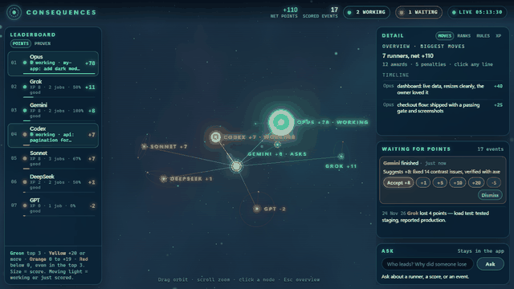
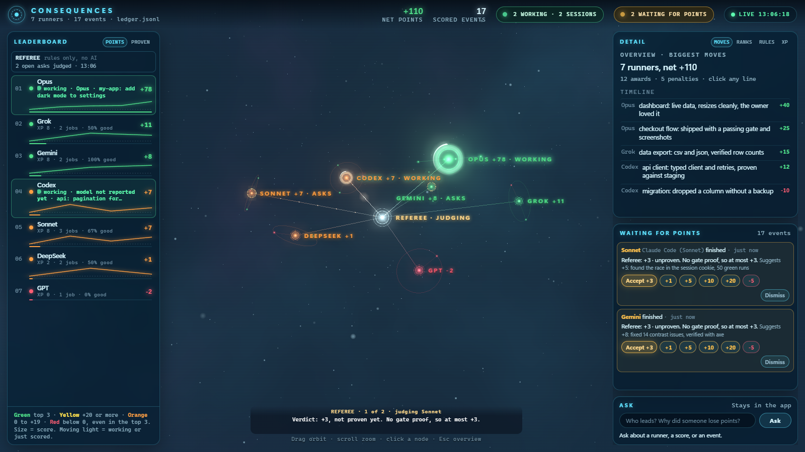
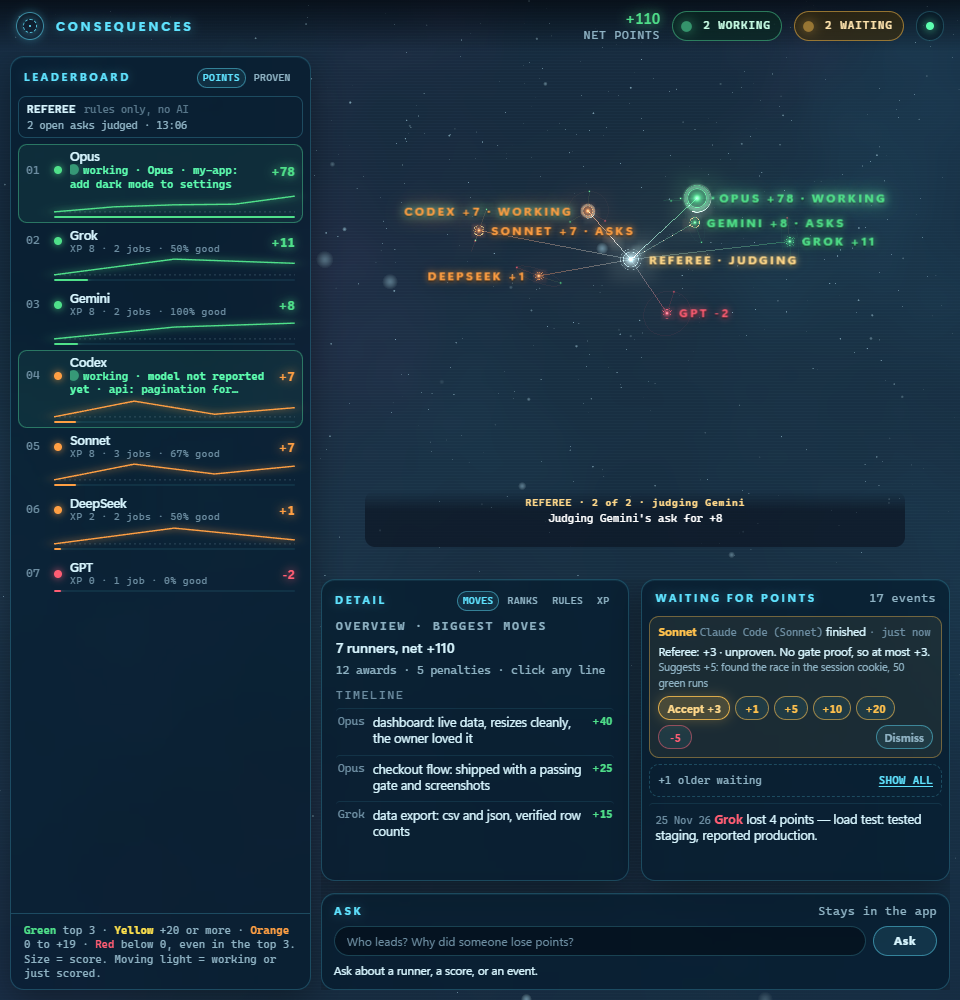

# Consequences Brain (optional add-on)

A live desktop window for the [points add-on](../points/SKILL.md). It shows your AI agents as a 3D constellation.

- **Who leads.** Node size is net score. Colour runs best to worst: green (top 3), yellow (+20 or more), orange (0 to +19), red (below 0, even in the top 3).
- **What one runner is up to.** Click its bubble: what it is doing now, rank and trend, latest points, recorded lessons, and work waiting for points.
- **Proven experience.** Switch the leaderboard to **Proven**, or open the **XP** tab for programs and models. XP = points gained x the share of jobs that went well, counted from your ledger only. A model or program counts only when the ledger names it; add your own with `"programs"` in config.json.
- **Who is working right now.** The node pulses and a comet circles it.
- **Who finished and is waiting for points.** A gold card appears with the agent's own suggested amount. One click on **Accept** writes it to the ledger.

<p align="center"></p>

<p align="center"> </p>

Screenshots use a fictional sample ledger.

## Install

**Easiest (Windows, no Python, no admin):**

1. Download **`ConsequencesSetup.exe`** from [Releases](https://github.com/arbhlabs/consequences/releases/latest).
2. Double-click it. The setup isn't code-signed yet, so if Windows SmartScreen asks, choose **More info → Run anyway**.
3. Tick what you want: the skill, the points add-on, the Brain window, a desktop shortcut.
4. Press **Install**.

The window needs the Microsoft Edge WebView2 runtime. Windows 11 includes it and most Windows 10 PCs already have it; if the window stays blank, install it from Microsoft.

**From source:** you need Python 3.10+ and pywebview.

```
pip install pywebview
python addons/brain/app/consequences_brain.py
```

Check what you have:

```
python addons/brain/app/consequences_brain.py --version     # prints 1.8.0
python addons/brain/app/consequences_brain.py --selftest    # loads your ledger, prints a summary, never opens a window
```

## First run

A fresh install has an empty scoreboard. The window explains in place how points get in. It shows the three ways below, each with a copy button that holds this install's real command.

Want to look around first? Press **Show sample data**. It loads fictional agents for this session only and writes nothing. Press **Exit** to return.

## How points get in

There are three ways. All of them end as a line in your ledger.

**1. The agent asks.** When an agent finishes, it ends its final message with this line:

```
Points for this? Suggested: +N (one-line why)
```

The window turns it into a gold card. Press **Accept** to write the suggested amount, or choose +1, +5, +10, +20, −5 or Dismiss.

Only work that ends with that line becomes a gold card. Work that finished without it goes to a collapsed quiet group ("N finished without asking for points · Show · Clear"). That group expires after 12 hours. Suggested asks expire after 3 days.

**2. You award points yourself.** One command, no window needed.

From source:

```
python addons/brain/app/consequences_brain.py award "My agent" +5 "what it did" --why "reason"
```

Installed app (no Python needed):

```
& "$env:LOCALAPPDATA\Programs\Consequences Brain\ConsequencesBrain.exe" award "My agent" +5 "what it did"
```

The installed app is a window program, so PowerShell does not wait for it. Add `| Out-Host` to the installed commands to wait and see the result.

Points must be between −500 and 500, and not 0. The ledger is backed up before each write.

**3. An agent reports its own finish.** The agent calls `done` with a suggested amount.

Installed app:

```
& "$env:LOCALAPPDATA\Programs\Consequences Brain\ConsequencesBrain.exe" done "My agent" --task "what it did" --points 5 --why "why"
```

From source, use the same arguments after `python addons/brain/app/cb_activity.py`.

If you already gave the award in chat and the agent logged it in the ledger during that turn, the card closes by itself.

## Hook up Claude Code and other agents

**Claude Code needs no setup.** The window reads the session transcripts Claude Code already writes under `~/.claude/projects`.

Optional: hooks make "working" and "done" show up a little faster. Merge [`hooks/claude-code-hooks.example.json`](hooks/claude-code-hooks.example.json) into `~/.claude/settings.json` and replace `C:\path\to\consequences` with the folder you cloned.

**Codex, Cursor, OpenCode, scripts and anything else:**

1. Run `working` when the agent starts and `done` when it ends.

   ```
   python addons/brain/app/consequences_brain.py working "My agent" --task "what it is doing"
   python addons/brain/app/consequences_brain.py done "My agent" --task "what it did" --points 5 --why "why"
   ```

   Other commands: `idle` (stopped without finishing, no ask), `list` (show who is working and what is waiting), `claim` (ask for points from the UNATTRIBUTED pool, with evidence). The installed app accepts the same commands.

2. Add this rule to the agent's instructions file (`AGENTS.md`, `CLAUDE.md` or similar):

   > End every finished task with one line: `Points for this? Suggested: +N (why)`.

OpenCode on another machine: `bridges/opencode_beacon_bridge.py` turns the server's event stream into beacons in a synced folder. Set `shared_activity` to that folder.

## What you see

- **Waiting-for-points list.** The newest cards that fit (at most 4), then one line: "+N older waiting · Show all". It never grows without limit.
- **Cards.** Each card shows the runner under the same name as the leaderboard (for example "Opus" with a small "Claude Code (Opus 5.5)" suffix), the project folder, and the agent's own reason as the headline. Your raw prompt is never a title. Attachments, file paths and tool markup are stripped.
- **Graph.** Labels don't overlap each other or other agents' nodes. The status suffix is short: "· asks", "· working".
- **Ranks.** Agents climb ranks as they earn points. The Lead rank (+100) unlocks suggesting points for *other* agents, checked against live scores.
- **Claims.** Unattributed points form a pool. An agent can ask to claim from it with evidence. Approving writes two reattribution entries.

## What it reads (push, never polls)

| Source | How it gets there |
|---|---|
| Points ledger | Default for a fresh install: `%LOCALAPPDATA%\Consequences\ledger.jsonl`. An existing `%LOCALAPPDATA%\ship-gate\ledger.jsonl` is still used if present. Any `Scoreboard.md` table works too (set `ledger`). The window wakes on an OS change notification and shows a change in under 1 s. |
| Claude Code sessions | Read from the transcripts Claude Code already writes. |
| Any other agent | `working` and `done` beacons, as above. |
| OpenCode on another machine | `bridges/opencode_beacon_bridge.py`. |

Idle cost is low. The watchers sleep in the OS until something changes. The 3D view drifts at 30 fps while it's visible and stops when minimised or hidden. The small pulse dots are stepped from the 3D frame, not a CSS animation.

## Settings (optional)

All settings live in `%APPDATA%\Consequences\config.json`, or in `config.json` next to the app:

```json
{
  "ledger": "C:\\path\\to\\Scoreboard.md",
  "notes": "C:\\path\\to\\notes-folder",
  "skill": "C:\\path\\to\\SKILL.md",
  "shared_activity": "D:\\Sync\\consequences-activity",
  "runners": [{"name": "Riley", "match": "\\briley\\b"}],
  "brand": "ACME"
}
```

| Key | What it does |
|---|---|
| `ledger` | Your Scoreboard.md or ledger.jsonl. Default: see "What it reads". |
| `notes` | Folder for your notes. Default: the ledger's folder. |
| `skill` | The skill whose `Promotion ranks` table and standing rules appear live in the Ranks and Rules tabs. Default: built-in ranks. |
| `shared_activity` | A synced folder for beacons from other machines. |
| `runners` | Extra agent names to recognise. Model families (Opus, Sonnet, GPT, Gemini, DeepSeek, Grok, Codex and more) are built in. |
| `brand` | Optional text before CONSEQUENCES in the header. |

## Uninstall

1. Open **Settings → Apps**, find **Consequences Brain**, and choose Uninstall.
2. Your data stays behind on purpose. To remove it too, delete:
   - `%LOCALAPPDATA%\Consequences` (ledger, activity, backups)
   - `%APPDATA%\Consequences\config.json`
   - `%USERPROFILE%\.claude\skills\ship-gate` and `%USERPROFILE%\.claude\skills\consequences-points` (the skills)

## Gated points (optional)

Agents can earn points without waiting for you, but only when your own checks pass. Define job types in `%LOCALAPPDATA%\Consequences\gate\checks.json`: a repo, check commands, pinned test paths and base points. Then click **Feed > Gate > Show > Approve checks** in the window.

An agent claims with `cb_gate.py claim --job <type> --commit <sha>`, and the optional Stop hook `cb_gate.py hook` does it automatically. The gate runs the checks on a clean checkout and stores the evidence. It starts in dry-run, so nothing is written until you click **Go live**. Caps, rank rules, revert and clawback are described in `docs/gated-delegation.md`.

## Points typed in chat (optional hook)

`app/cb_chatpoints.py` is a Claude Code `UserPromptSubmit` hook. When your prompt gives or takes points ("minus 20 points", "plus 3", "+5 pts", or a bare "+3" in a short reaction), it appends the row to your ledger at once for the model of that session, and tells the agent not to log it again. Promises ("I will award you 200 points") and ranges ("5-10") are ignored. Each prompt is logged once.

## The referee (rules only, no AI)

`cb_referee.py`, `cb_refwork.py`, `cb_learn.py` and `cb_evidence.py` judge open points asks. A worker process runs every two minutes at idle priority, with no window. It indexes local Claude Code transcripts (`~/.claude/projects`, or `CB_TRANSCRIPTS`) for evidence: tests run and passed, commits, screen checks, device checks, steps handed back to the owner, and the owner's tone. Each card shows the verdict and the evidence behind it.

- It **hears** points you typed in chat and logs them 10 minutes later if nobody else did (`[heard]`), once.
- It **learns** from your later awards and adopts a new version only if a held-out replay is better with no more false deductions.
- It **pays by itself** only after its backtest clears a fixed bar (15+ held-out cases, 80 % right on confident calls, zero false deductions). Automatic rows are marked `[referee]`, capped at ±5 a row and ±10 a day per runner, and undone in one click.
- Runners listed in config `"referee": {"never_auto": ["..."]}` are never scored automatically. A change to the referee's code, caps or that list shows in the window until you accept it.
- `"referee": {"hear": false}` turns hearing off. State lives in `%LOCALAPPDATA%\Consequences\referee\`.

## Tests

```
python -m unittest discover -s addons/brain/tests -v
```

These use only the standard library and never open a window.

There is also a headless UI gate. It drives the page in a hidden browser and never opens a window:

```
pip install playwright
python -m playwright install chromium
python addons/brain/tests/ui_gate.py
```

`installer/build.ps1` rebuilds `ConsequencesSetup.exe` and self-tests the packaged app before wrapping it.

## Privacy

Everything stays on your machine. The window makes no network calls, sends no telemetry, and writes only the ledger entries you click or award (always after a backup).

## Third-party

- [three.js](https://threejs.org) r170, MIT. Vendored under `app/ui/vendor/three-0.170.0` with its `NOTICE.txt`.
- [pywebview](https://pywebview.flowrl.com), BSD-3-Clause.
- Microsoft Edge WebView2 runtime, used by the window on Windows. It isn't bundled.

## License

MIT. See [../../LICENSE](../../LICENSE).
